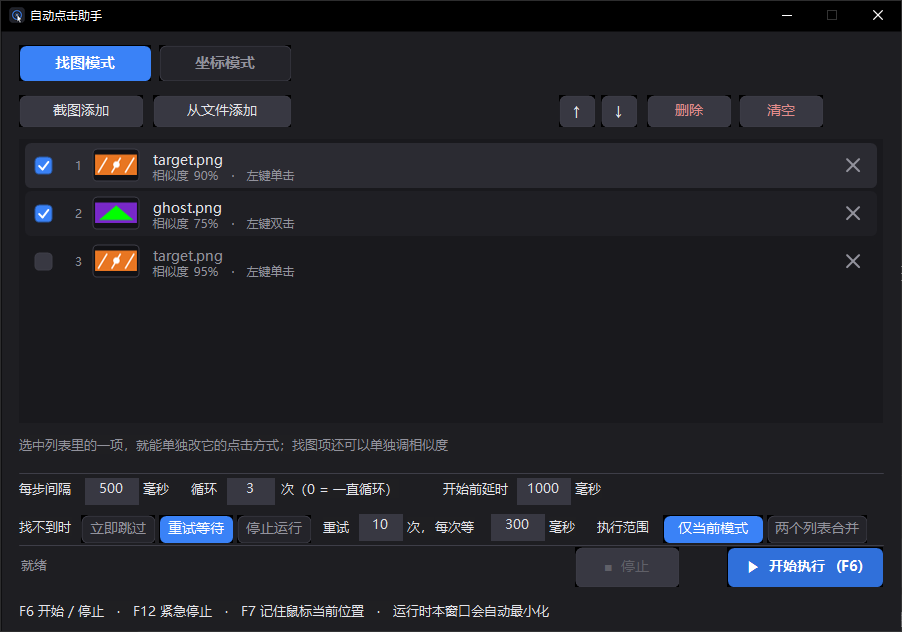
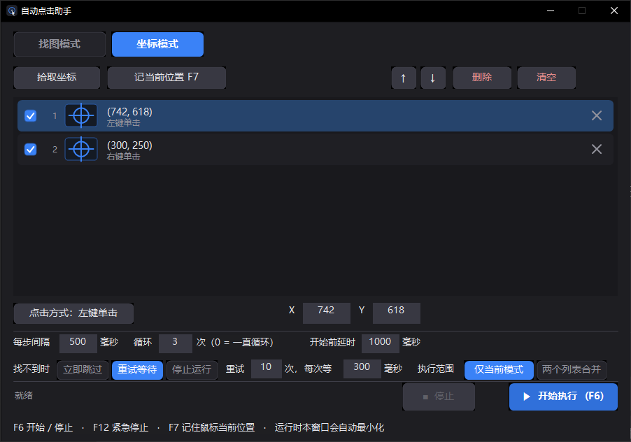
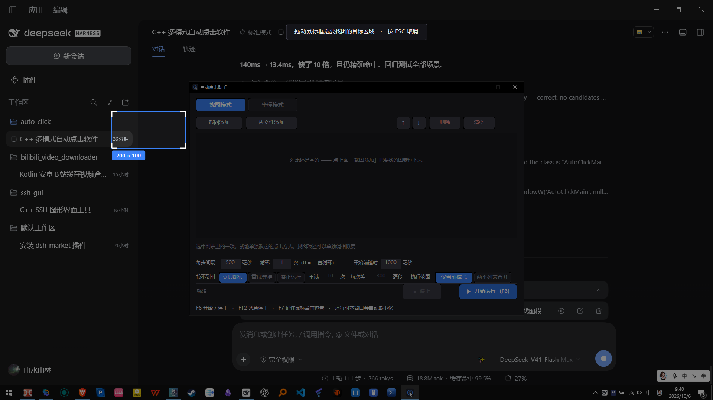

# 自动点击助手（AutoClick）

一个用 C++（纯 Win32 API + GDI+）写的 Windows 自动点击小工具。
**免安装、单文件 exe（约 376 KB）、不写注册表、不装服务、不开机自启**，拷到哪都能跑。

## 界面预览

| 找图模式 | 坐标模式 |
|:---:|:---:|
|  |  |

内置框选截图：点「截图添加」后整个屏幕冻结变暗，拖一个框就完成，不用另外开截图软件。



---

## 一、它能做什么

两个模式，各自维护一份**有序列表**，按列表从上到下依次执行。

### 🔍 找图模式
先在屏幕上把要找的图案**框下来**（内置截图，不用另外开截图软件），再让程序去屏幕上找它，
**找到就点它命中的位置**（默认点图案正中间）。

- 内置全屏框选截图：按「截图添加」，整个屏幕会冻结变暗，拖一个框就完成
- 也可以「从文件添加」已有的 PNG / JPG / BMP 图片
- 每个找图项都能单独调**相似度阈值**（50%–100%，默认 90%）

### 📍 坐标模式
按「拾取坐标」，屏幕上会出现一个跟随鼠标的**实时坐标提示条**，
在目标位置点一下鼠标，坐标就直接进了列表。也可以按 `F7` 把鼠标当前位置悄悄记下来，不打断手上的操作。

- 点一下就读出坐标，不用手抄、不用换算
- 已加入列表的坐标可以选中后直接改 X / Y

### 两个模式共用的能力

| 能力 | 说明 |
|---|---|
| 顺序执行 | 列表从上到下依次执行，可**拖拽行**调整顺序，也可用 ↑ ↓ 按钮 |
| 单独启用 / 停用 | 每行左侧的勾选框，不用删掉就能临时跳过某项 |
| 点击方式 | 左键单击 / 左键双击 / 右键单击 / 中键单击，每项单独设置 |
| 循环执行 | 循环次数可设 1~100000，填 `0` 表示一直循环到手动停止 |
| 找不到图时 | 三种处理：立即跳过 / 重试等待（可设次数和间隔）/ 停止运行 |
| 执行范围 | 只跑当前模式的列表，或把「找图列表 + 坐标列表」按顺序合并执行 |
| 随手停止 | `F6` 开始/停止，`F12` 紧急停止；点了立刻响应（最多 25 毫秒） |
| 自动最小化 | 开始执行时本窗口自动最小化，不挡着目标程序 |
| 配置自动保存 | 退出时自动存到 exe 同目录的 `config.ini`，下次打开原样恢复 |

---

## 二、快速开始

1. 双击 `AutoClick.exe`
2. **找图**：切到「找图模式」→ 点「截图添加」→ 在屏幕上拖框选住要点的按钮 → 列表里就多了一项
3. **坐标**：切到「坐标模式」→ 点「拾取坐标」→ 在目标位置点一下 → 列表里就多了一项
4. 需要的话调一下「每步间隔」（默认 500 毫秒）和「循环」次数
5. 按 **`F6`**（或点「开始执行」）→ 窗口自动最小化 → 开始按列表顺序点击
6. 再按 **`F6`** 或 **`F12`** 停止

---

## 三、界面说明

```
┌──────────────────────────────────────────────────────────────┐
│  [ 找图模式 ]  [ 坐标模式 ]                                   │  标签页
├──────────────────────────────────────────────────────────────┤
│  [截图添加] [从文件添加]        [↑] [↓] [删除] [清空]          │  工具条
│  ┌────────────────────────────────────────────────────────┐  │
│  │ ☑ 1 [缩略图] 按钮A.png  相似度 90% · 左键单击       ✕ │  │  列表
│  │ ☑ 2 [缩略图] 图标B.png  相似度 75% · 左键双击       ✕ │  │
│  └────────────────────────────────────────────────────────┘  │
│  点击方式：左键单击      X [742]  Y [618]                     │  选中项参数
├──────────────────────────────────────────────────────────────┤
│  每步间隔 [500] 毫秒   循环 [3] 次（0 = 一直循环） 开始前延时  │  运行参数
│  找不到时 [立即跳过][重试等待][停止运行] 重试 [10] 次，每次等  │
│  执行范围 [仅当前模式][两个列表合并]                          │
├──────────────────────────────────────────────────────────────┤
│  就绪                              [■ 停止]  [▶ 开始执行 F6]  │  状态 + 控制
└──────────────────────────────────────────────────────────────┘
```

- 选中列表里的一项，就能在「选中项参数」那一行单独改它的点击方式（找图项还能改相似度）
- 没选中任何项时那一行是灰色提示

---

## 四、快捷键

| 按键 | 作用 |
|---|---|
| `F6` | 开始执行 / 停止（全局有效，窗口最小化也管用） |
| `F12` | 紧急停止 |
| `F7` | 把鼠标**当前**位置直接加进坐标列表（不打断操作） |
| `ESC` | 取消正在进行的截图框选 / 坐标拾取 |
| 列表里 `↑` `↓` | 上下移动选中行 |
| 列表里 `空格` | 勾选 / 取消勾选当前项 |
| 列表里 `Delete` | 删除当前项 |

---

## 五、性能

在本机（1920×1080 全屏，模板 140×70）实测：

| 项目 | 实测值 |
|---|---|
| 全屏找图一次 | **约 13 毫秒** |
| 其中：画面灰度化 | 4 毫秒 |
| 其中：候选位置粗筛（8 线程） | 9 毫秒 |
| 其中：候选位置精算 | < 1 毫秒 |
| 单次点击的动作耗时 | 约 75 毫秒（移动 → 按下 → 抬起，让目标程序稳稳定位） |
| 程序体积 | 376 KB（单文件，静态链接，不依赖 VC++ 运行库） |

找图算法分两级：
1. **粗筛**：灰度差的绝对值之和，SSE2 一次比 16 个像素，8 线程分片。
   关键优化是**按行等比例提前淘汰** —— 每算完一行就按比例检查，
   明显不匹配的位置第一行就被丢掉（早期版本用总预算判定，要跑十几行才退出，慢了 10 倍）。
2. **精算**：对少数候选位置算 ZNCC（去均值归一化互相关）。
   它对整体明暗变化不敏感，而且当屏幕那块区域是**一片纯色**时分数天然很低 ——
   这正是防止"点在空白处"的关键。

---

## 六、常见问题

**Q：提示"没找到"，但我明明看到图案在屏幕上？**
1. 把该行的**相似度调低一点**（比如从 90% 调到 80%）——状态栏会显示实际匹配到的最高相似度，照着它调
2. 截取模板时**只框图案本身**，别把大片背景一起框进去
3. 如果目标窗口被拉伸、换过分辨率或系统缩放过，图案尺寸就变了，**需要重新截一次**
4. 目标如果被别的窗口挡住了，自然也找不到

**Q：点了「开始执行」但鼠标没动？**
- 看状态栏的文字。如果写着"点击被系统拦截"之类的提示，**试试右键 exe →「以管理员身份运行」**
- 这是 Windows 的保护机制：目标程序以管理员身份运行时，普通权限的程序不允许向它发送模拟点击

**Q：运行期间我还能用鼠标吗？**
- **不能。** 程序发的是真实鼠标动作，运行期间鼠标会被它占用。
  这是刻意的设计——模拟真实点击才能被几乎所有程序（包括游戏）接受。

**Q：支持哪些画面？**
- 普通 Windows 程序窗口：完全没问题（浏览器、办公软件、模拟器窗口、自己写的程序等）
- **由显卡直接绘制的画面**（3D 游戏、部分视频播放器）：普通截图可能截到一片黑，找图会失效

**Q：程序会往系统里装东西吗？**
- 不会。不写注册表、不装服务、不设开机自启。所有文件只在 exe 同目录：
  - `config.ini` —— 列表和设置
  - `images\` —— 你截下来的模板图
  - 删除整个文件夹就等于彻底卸载

**Q：想换台电脑用怎么办？**
- 把整个文件夹拷过去就行。配置里的图片路径是**相对 `images` 目录**的，拷过去照样能用。
  （如果图片是从别处"从文件添加"进来的，程序也已经复制了一份到 `images\`）

**Q：点错了想让它别点某个位置？**
- 把那一行左边的勾去掉即可，不用删除。

---

## 七、从源码编译

需要 **Visual Studio 生成工具 2022**（含「使用 C++ 的桌面开发」工作负载）。

```bat
build.bat          :: Release 构建
build.bat debug    :: Debug 构建
build.bat w4       :: Release + /W4 严格警告
```

产物在 `bin\AutoClick.exe`。构建脚本会自己定位 `vcvars64.bat`，不需要先开「Developer Command Prompt」。

### 项目结构

```
auto_click/
├─ src/
│  ├─ app.h          共享类型、控件 ID、模块接口
│  ├─ main.cpp       主窗口、布局、标签页、消息处理
│  ├─ ui_common.cpp  DPI 适配、深色主题、字体缓存、绘图辅助、配置读写、日志
│  ├─ imaging.cpp    屏幕抓取、模板匹配引擎、缩略图、PNG 保存
│  ├─ overlay.cpp    框选截图覆盖层 + 坐标拾取覆盖层
│  ├─ listview.cpp   深色自绘列表（勾选 / 拖拽排序 / 滚动）
│  └─ engine.cpp     后台执行线程
├─ res/              图标、版本信息、资源头
├─ build.bat         一键构建
└─ README.md
```

### 实现要点

- **界面**：不使用 MFC / Qt / .NET，全部是 Win32 API + GDI+ 自绘。按钮、标签页、列表都是自己画的，
  四个状态（常态 / 悬停 / 按下 / 禁用）自己维护，所以深色主题下不会出现系统控件的白边和系统配色。
- **DPI**：进程声明 `PER_MONITOR_AWARE_V2`，所有尺寸走 `MulDiv(值, dpi, 96)`，处理 `WM_DPICHANGED`。
- **点击**：`SendInput` + 绝对坐标（0~65535 归一化到整个虚拟桌面），落点精确到像素。
- **线程**：执行逻辑全在后台线程，UI 线程不阻塞；停止信号是 `std::atomic<bool>`，
  所有等待都切成 ≤25 毫秒的小片轮询，所以"停止"按下去立刻有反应。

### 排障用日志

正常使用**不产生任何日志文件**。需要排查时，先设环境变量再启动：

```bat
set AUTO_CLICK_LOG=1
AutoClick.exe
```

会在 exe 同目录生成 `debug.log`，记录每一步的执行、找图耗时分解、`SendInput` 是否被拒绝等。
**程序崩溃时的异常码和调用栈也永远写进这个文件**（不需要开日志开关），方便定位问题。

---

## 八、已知限制

1. **只支持前台点击**：运行期间鼠标被占用，不能同时干别的。
   （"后台点击"需要驱动级手段，且对很多程序根本无效，所以没有做。）
2. **不支持缩放匹配**：模板按原始尺寸匹配。如果之后改了系统缩放比例或目标窗口大小，
   需要重新截图。
3. **硬件加速画面可能截不到**：见上文「支持哪些画面」。
4. **单实例运行**：重复启动会激活已有窗口，不会开出第二个。

---

## 九、许可证

**GNU General Public License v3.0（GPL-3.0）**，全文见 [LICENSE](LICENSE)。

Copyright (C) 2026 Lin1848624

这意味着你可以自由使用、修改、再分发，但**派生作品也必须以 GPL-3.0 开源**，
并且不能附加额外限制。本程序分发时**不提供任何担保**（详见许可证第 15、16 条）。

如果你只需要一个能用的工具而不打算改代码，直接把 exe 拿去用即可——
GPL 对"使用"没有限制，约束的是"分发和修改"。
